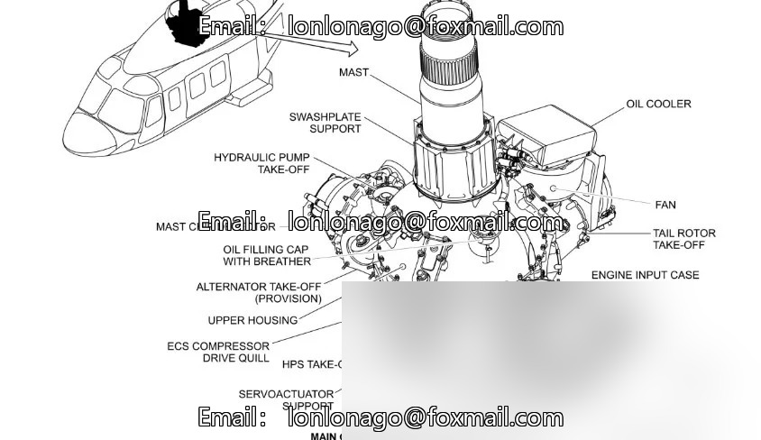
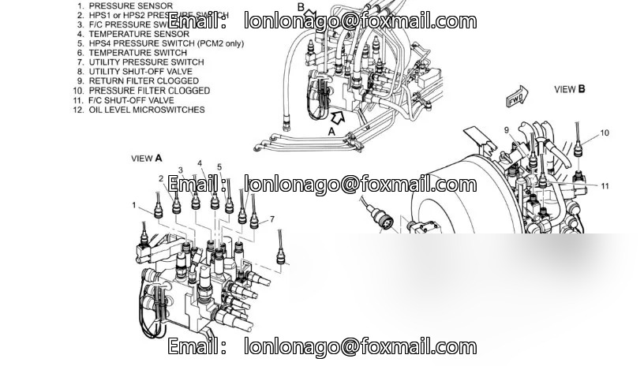
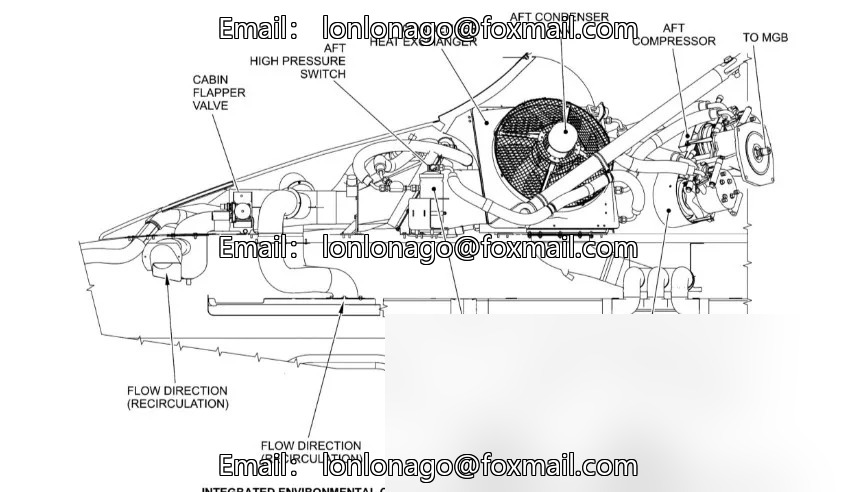
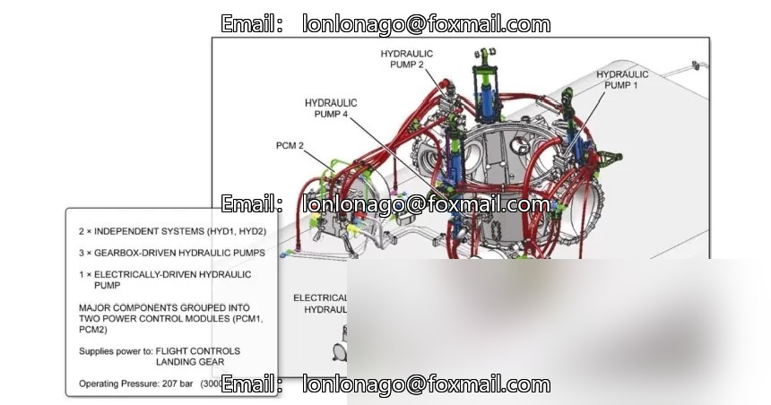
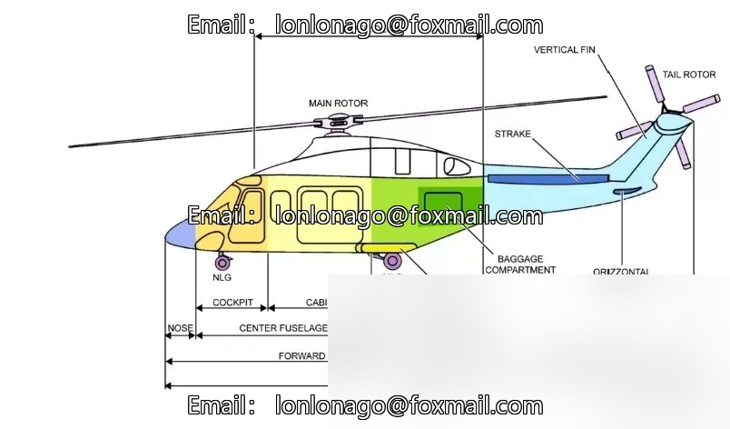

# Leonardo AW139 maintenance model training manual (CAT. B1.)

## Body

Leonardo AW139 maintenance training manual (CAT. B1.3)
PDF file 2200 pages
content covers AW139 helicopter maintenance, system principles, operation processes, etc., suitable for aviation maintenance and training reference.
Requires direct shooting, contact privately for issues.
978584658-PM..

The manual covers AW139 helicopter body maintenance, system principles and operation procedures, along with multiple maintenance equipment and components.

<!-- AI_ENRICHED -->

## Images

## Payment

Here is a pay link on Stripe ( https://buy.stripe.com/3cs8yP7sY87d0vu9AB ). Please contact me lonlonago@foxmail.com after funding $89, and I will send you a complete data files , thank you!

